# Ingress XM Anomalies

XM Anomalies by year, from 2013 to 2026, as of 4 November 2026. No XM Anomalies are scheduled after 19 September 2026.

See also: [Mission Days](./mission-days).

## How reliable this is

| Years | Source | Reliability |
|---|---|---|
| 2022–2026 | Schedules and season pages on [ingress.com/news](https://ingress.com/news) | Official |
| 2018–2019 | [GameGnome list of announced events](https://gamegnome.com/news/ingress-real-world-global-event-locations-and-dates-for-2018-and-2019/) | Announced dates, not checked against what happened. Series names matched by date |
| 2015–2022 | [Global Resonator](https://globalresonator.com/tag/anomaly/), the Fevgames reports on a new site | Community reports. Used for Persepolis, the 2016 series, Darsana Prime, the 2019 Nemesis series and Kureze Effect. Countries mostly filled in from the city names |
| 2013–2017 | [Ingress Wiki](https://ingress.wiki.gg/wiki/Anomaly) for sites, [Fevgames](https://fevgames.net/ingress/ingress-guide/concepts/anomaly/) for dates and scores | Community records |

The flags show the country. The Role shows a primary or satellite site. A dash means the source does not say. When signed in, you can mark a site you attended, and it is added to your timeline.

A medal you saved in your custom medals is added to your timeline: on the last Anomaly of its series, or on the last day of the season for a tiered season medal.

## How medals were earned

The note under each series gives its rule, from the official rules or season page of that series unless it says otherwise. This covers the main medal of each series. Several seasons from 2024 on also had a separate Operation or Global Campaign medal.

- **2014–2019, except Umbra:** Agents registered in advance on the event page, and the medal was sent to the scanner once their participation was confirmed. Earlier events also used passcode cards. This general rule is from [Fevgames](https://fevgames.net/ingress/ingress-guide/concepts/medal/), and no official rule per series was found.
- **2022 to +Alpha:** Most medals came from Battle Beacons, which an Agent interacts with by deploying or upgrading a Resonator, attacking or destroying a Resonator, destroying a Mod or Link, or recharging. Upgrading their own Resonator does not count. An Agent gets a series medal only once.
- **From +Theta on:** Most seasons have a tiered medal for tokens from the whole season, such as bounties, campaigns and attending an Anomaly. Each season page lists the sources. An Anomaly site alone does not reach the top tier.

## Gaps

- **Initio:** there is a medal, but no source gives its dates, so it is not listed here and not added to the timeline.
- **Incomplete site lists:** no list was found for Darsana, nor for the first day of Via Lux. Persepolis and the second day of Aegis Nova have no dates per site.
- **2020–2021:** the Requiem Anomaly of 9 May 2020 was cancelled because of COVID-19. No in-person Anomaly from then until 2022 was found.
- **Results after 2020:** scores and winners are not included, so those columns show a dash. Kureze Effect is the exception, with its winner.
- **Skirmishes and Shard events:** the 2024–2026 seasons also had Skirmishes and Shard Storms at many more sites. They are not listed here.

## All series

The medal of each series, as images from the app. Where a season has its own medal for the XM Anomalies, that Onsite Medal is shown. Otherwise a medal with tiers is shown in its highest tier. No image is available for Requiem. Cassandra and 13MAGNUS came before the first medal.

Dates and scores up to 2020 are from Fevgames. Early events used different scoring, so scores can only be compared within one event.

| Medal | Series | Dates | ENL | RES | Winner |
|---|---|---|---|---|---|
| – | Cassandra | 11–24 Aug 2013 | 4,548 | 3,805 | ENL |
| – | 13MAGNUS | 12 Oct 2013 | 14,931 | 11,076 | ENL |
|  | Recursion | 15 Feb – 29 Mar 2014 | 6,264 | 8,496 | RES |
| 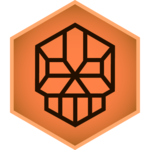 | Interitus | 12 Apr – 21 Jun 2014 | 13,656.75 | 14,459.75 | RES |
|  | Helios | 26 Jul – 27 Sep 2014 | 11,453.032 | 13,978.682 | RES |
|  | Darsana | 18 Oct – 13 Dec 2014 | 6,307.6 | 8,213.2 | RES |
|  | Shōnin | 21 Feb – 28 Mar 2015 | 15,208 | 23,918 | RES |
|  | Persepolis | 30 May – 20 Jun 2015 | 22,146 | 22,575 | RES |
| 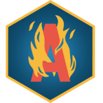 | Abaddon | 10 Oct – 12 Dec 2015 | 12 | 13 | RES |
| 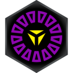 | Obsidian | 27 Feb – 2 Apr 2016 | 27,625 | 21,741 | ENL |
|  | Aegis Nova | 28 May – 16 Jul 2016 | 26,913 | 20,782 | ENL |
| 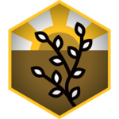 | Via Lux | 27 Aug – 24 Sep 2016 | 19 | 20 | RES |
| 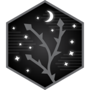 | Via Noir | 12 Nov 2016 | 10,364 | 9,621 | ENL |
|  | 13MAGNUS Reawakens | 26 Aug – 23 Sep 2017 | 11.5 | 8.5 | ENL |
|  | EXO5 | 4 Nov – 2 Dec 2017 | 11.5 | 10 | ENL |
| 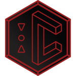 | Cassandra Prime | 28 Jul – 25 Aug 2018 | 11 | 7 | ENL |
|  | Recursion Prime | 20 Oct – 17 Nov 2018 | 8 | 13 | RES |
|  | Darsana Prime | 23 Feb – 23 Mar 2019 | – | – | – |
| 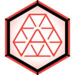 | Abaddon Prime | 4–25 May 2019 | 1 | 2 | RES |
| 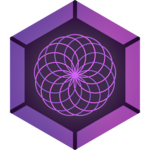 | Nemesis: Myriad | 27 Jul 2019 | 5 | 3 | ENL |
| 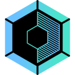 | Nemesis: Umbra | 12 Oct 2019 | 7 | 2 | ENL |
| – | Requiem | 9 May 2020 | – | – | Cancelled |
|  | Kureze Effect | Jan – Mar 2022 | – | – | ENL |
|  | Kythera | Apr – Jun 2022 | – | – | – |
|  | Superposition | Jul – Aug 2022 | – | – | – |
| 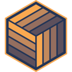 | Epiphany Dawn | Nov – Dec 2022 | – | – | – |
|  | MZFPK | 18 Mar 2023 | – | – | – |
| 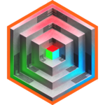 | Echo | Apr – Jun 2023 | – | – | – |
| 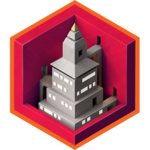 | Ctrl | Jul – Sep 2023 | – | – | – |
| 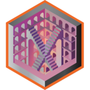 | Discoverie | Oct – Dec 2023 | – | – | – |
| 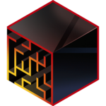 | Cryptic Memories | Feb – Mar 2024 | – | – | – |
| 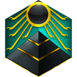 | Buried Memories | Apr – Jun 2024 | – | – | – |
|  | Shared Memories | Jul – Sep 2024 | – | – | – |
|  | Erased Memories | Oct – Dec 2024 | – | – | – |
|  | +Alpha | Jan – Mar 2025 | – | – | – |
|  | +Theta | Apr – Jun 2025 | – | – | – |
|  | +Delta | Jul – Sep 2025 | – | – | – |
|  | +Beta | Oct – Dec 2025 | – | – | – |
|  | +Gamma | Jan – Mar 2026 | – | – | – |
|  | Orion | Apr – Jun 2026 | – | – | – |
|  | Apollo | Jul – Sep 2026 | – | – | – |
|  | Cygnus | Oct – Dec 2026, no XM Anomalies | – | – | – |

Fevgames also lists 11 smaller events from January to July 2013 and some special events, such as Ingress Campus and DICE2014.

## 2026

###  Cygnus

October to December, no XM Anomalies. [Season overview](https://ingress.com/news/2026-cygnus).

**Medal:** Season medal for Cygnus Tokens: Bronze 6,000, Silver 12,000, Gold 24,000.

###  Apollo

July to September. [Season overview](https://ingress.com/news/2026-apollo).

**Medal:** Season medal for Apollo Tokens: Bronze 4,000, Silver 8,000, Gold 16,000. The Onsite Medal was for taking part in any Anomaly battle onsite.

| Date | Site | Role |
|---|---|---|
| 18 Jul | 🇨🇴 Bogotá, Colombia | – |
| 18 Jul | 🇫🇮 Helsinki, Finland | – |
| 22 Aug | 🇫🇷 Paris, France | – |
| 22 Aug | 🇰🇷 Seoul, South Korea | – |
| 19 Sep | 🇺🇸 Denver, CO, USA | – |
| 19 Sep | 🇸🇬 Singapore | – |

###  Orion

April to June. [Season overview](https://ingress.com/news/2026-orion).

**Medal:** Season medal for Orion Tokens: Bronze 5,000, Silver 8,000, Gold 15,000, Platinum 25,000. The Onsite Medal was for taking part in any Anomaly battle onsite.

| Date | Site | Role |
|---|---|---|
| 16 May | 🇨🇿 Prague, Czechia | – |
| 16 May | 🇦🇺 Sydney, NSW, Australia | – |
| 30 May | 🇺🇸 Jersey City, New Jersey, USA | – |
| 30 May | 🇯🇵 Kure City, Hiroshima Pref, Japan | – |
| 20 Jun | 🇨🇭 Geneva, Switzerland | – |
| 20 Jun | 🇵🇪 Lima, Peru | – |

###  +Gamma

January to March. [Season overview](https://ingress.com/news/2026-plusgamma).

**Medal:** Season medal for +Gamma Tokens: Bronze 500, Silver 3,000, Gold 7,500. The Onsite Medal was for taking part in any Anomaly battle onsite.

| Date | Site | Role |
|---|---|---|
| 28 Feb | 🇺🇸 Charlotte, NC, USA | – |
| 28 Feb | 🇵🇹 Lisbon, Portugal | – |
| 14 Mar | 🇭🇰 Hong Kong | – |
| 14 Mar | 🇭🇷 Zagreb, Croatia | – |
| 21 Mar | 🇦🇷 Buenos Aires, Argentina | – |
| 21 Mar | 🇮🇳 Hyderabad, Telangana, India | – |

The Cygnus season (October to December) has Shard Storms and global events, but no XM Anomalies.

## 2025

###  +Beta

[Season page](https://ingress.com/news/2025-plusbeta).

**Medal:** Season medal for +Beta Tokens: Bronze 3,000, Silver 6,000, Gold 9,000. A hack at an Anomaly site gave 3,000 and its other Site Bounties 2,000 more.

| Date | Site | Role |
|---|---|---|
| 18 Oct | 🇧🇷 São Paulo, Brazil | – |
| 18 Oct | 🇪🇸 Valencia, Spain | – |
| 25 Oct | 🇺🇸 Houston, TX, USA | – |
| 25 Oct | 🇳🇿 Wellington, New Zealand | – |
| 15 Nov | 🇹🇼 Taoyuan, Taiwan | – |
| 15 Nov | 🇳🇱 The Hague, Netherlands | – |

###  +Delta

[Season page](https://ingress.com/news/2025-plusdelta).

**Medal:** Season medal for +Delta Tokens: Bronze 3,000, Silver 8,000, Gold 15,000. An Anomaly site gave up to 5,000.

| Date | Site | Role |
|---|---|---|
| 16 Aug | 🇲🇾 Malacca City, Malaysia | – |
| 16 Aug | 🇺🇸 Portland, OR, USA | – |
| 23 Aug | 🇸🇪 Gothenburg, Sweden | – |
| 23 Aug | 🇨🇦 Quebec City, Canada | – |
| 20 Sep | 🇬🇧 Cambridge, United Kingdom | – |
| 20 Sep | 🇮🇩 Denpasar City, Bali, Indonesia | – |

###  +Theta

[Season page](https://ingress.com/news/2025-plustheta).

**Medal:** Season medal for +Theta Tokens: Bronze 2,000, Silver 4,000, Gold 6,000. An Anomaly site gave up to 2,500.

| Date | Site | Role |
|---|---|---|
| 17 May | 🇵🇭 Manila, Metro Manila, Philippines | – |
| 17 May | 🇺🇸 Providence, RI, USA | – |
| 14 Jun | 🇩🇪 Chemnitz, Germany | – |
| 14 Jun | 🇦🇺 Perth, WA, Australia | – |

###  +Alpha

[Season page](https://ingress.com/news/2025-plusalpha).

**Medal:** One NIASection14 Battle Beacon at an Anomaly site, one Rare Battle Beacon or a Shard Portal hack at a Shard Skirmish, or one Very Rare Battle Beacon at a Battle Beacon Skirmish.

| Date | Site | Role |
|---|---|---|
| 15 Feb | 🇯🇵 Yokosuka, Kanagawa, Japan | – |
| 22 Feb | 🇺🇸 Tucson, AZ, USA | – |
| 22 Mar | 🇮🇹 Naples, Italy | – |

## 2024

###  Erased Memories

[Season details](https://ingress.com/news/2024-erasedmem).

**Medal:** Five Battle Beacons at Anomaly sites, one local Battle Beacon or a Shard Portal hack at a Shard Skirmish, or five local Battle Beacons at a Battle Beacon Skirmish.

| Date | Site | Role |
|---|---|---|
| 2 Nov | 🇹🇼 Tainan | – |
| 2 Nov | 🇪🇸 Valencia | cancelled because of [flooding](https://ingress.com/news/2024-erasedmem-valenciacanceled) |
| 14 Dec | 🇳🇿 Christchurch | – |
| 14 Dec | 🇺🇸 Nashville, TN | – |

###  Shared Memories

[Season details](https://ingress.com/news/2024-sharedmem).

**Medal:** Five NIASection14 Battle Beacons in an Anomaly Zone, or a local Battle Beacon or a Shard Portal hack at a Shard Skirmish.

| Date | Site | Role |
|---|---|---|
| 17 Aug | 🇳🇱 Rotterdam | – |
| 17 Aug | 🇸🇬 Singapore | – |
| 21 Sep | 🇯🇵 Hakodate | – |
| 21 Sep | 🇺🇸 Seattle | – |

###  Buried Memories

[Season details](https://ingress.com/news/2024-buriedmem).

**Medal:** Five NIASection14 Battle Beacons in an Anomaly Zone, or a local Battle Beacon or a Shard Portal hack at a Shard Skirmish.

| Date | Site | Role |
|---|---|---|
| 18 May | 🇯🇵 Naha | – |
| 25 May | 🇺🇸 Chicago | [moved from 18 May](https://ingress.com/news/2024-chicago-anomaly) |
| 15 Jun | 🇭🇺 Budapest | – |
| 15 Jun | 🇲🇾 Kuching | – |

###  Cryptic Memories

[Series details](https://ingress.com/news/2024-crypticmem).

**Medal:** Five NIASection14 Battle Beacons in an Anomaly Zone, top 50 of a faction in a Cell Battle, or a local Battle Beacon at a Shard Night. [Rules](https://ingress.com/news/2024-crypticmem).

| Date | Site | Role |
|---|---|---|
| 17 Feb | 🇦🇺 Adelaide | – |
| 17 Feb | 🇨🇱 Santiago | – |
| 16 Mar | 🇲🇴 Macau | – |
| 16 Mar | 🇵🇹 Porto | – |

## 2023

###  Discoverie

[October to December schedule](https://ingress.com/news/2023-q4-events).

**Medal:** Five NIASection14 Battle Beacons in Phases 1, 3 or 5, 30 claimed Kinetic Programs in Phase 2, or 100 reclaimed Machina Portals in Phase 4. [Rules](https://ingress.com/news/discoverie-rules).

| Date | Site | Role |
|---|---|---|
| 14 Oct | 🇪🇸 Madrid, Spain | Primary |
| 14 Oct | 🇹🇼 Taichung, Taiwan | Satellite |
| 14 Oct | 🇧🇷 Curitiba, Brazil | Satellite |
| 18 Nov | 🇹🇭 Bangkok, Thailand | Primary |
| 18 Nov | 🇮🇹 Palermo, Italy | Satellite |
| 18 Nov | 🇺🇸 Atlanta, GA, USA | Satellite |
| 16 Dec | 🇺🇸 Honolulu, HI, USA | Primary |
| 16 Dec | 🇱🇰 Colombo, Sri Lanka | Satellite |
| 16 Dec | 🇹🇷 İzmir, Turkey | Satellite |

###  Ctrl

[July to September schedule](https://ingress.com/news/2023-q3-events).

**Medal:** Five NIASection14 Battle Beacons in Ctrl Anomaly Zones. [Rules](https://ingress.com/news/ctrl-rules).

| Date | Site | Role |
|---|---|---|
| 15 Jul | 🇧🇴 Santa Cruz de la Sierra, Bolivia | Primary |
| 15 Jul | 🇮🇩 Bandung, Indonesia | Satellite |
| 15 Jul | 🇩🇪 Rotenburg a.d. Fulda, Germany | Satellite |
| 19 Aug | 🇳🇴 Oslo, Norway | Primary |
| 19 Aug | 🇺🇸 Charleston, WV, USA | Satellite |
| 19 Aug | 🇰🇷 Songpa, Seoul, South Korea | Satellite |
| 16 Sep | 🇯🇵 Kobe, Japan | Primary |
| 16 Sep | 🇺🇸 Tacoma, WA, USA | Satellite |
| 16 Sep | 🇫🇷 Reims, France | Satellite |

###  Echo

[April to June schedule](https://ingress.com/news/2023-q2-events).

**Medal:** Five NIASection14 Battle Beacons in any Phase. [Rules](https://ingress.com/news/echo-rules).

| Date | Site | Role |
|---|---|---|
| 22 Apr | 🇺🇸 Jacksonville, FL, USA | Primary |
| 22 Apr | 🇵🇭 Baguio City, Philippines | Satellite |
| 22 Apr | 🇿🇦 Pietermaritzburg, South Africa | Satellite |
| 20 May | 🇦🇺 Brisbane, Australia | Primary |
| 20 May | 🇺🇾 Montevideo, Uruguay | Satellite |
| 20 May | 🇬🇧 Brighton, UK | Satellite |
| 17 Jun | 🇬🇷 Athens, Greece | Primary |
| 17 Jun | 🇨🇦 Winnipeg, Canada | Satellite |
| 17 Jun | 🇯🇵 Ueda, Nagano, Japan | Satellite |

###  MZFPK

Global, held on 18 March through Agent Ops. [Announcement](https://ingress.com/news/2023-mzfpk).

**Medal:** All six Agent Ops by 23:59 local time: trek 6 km, 60 hacks, deploy 60 Resonators and 16 Mods, 60 Glyph Points, destroy 24 Resonators.

## 2022

These series ran in phases. Some phases were global or used Impact Zones instead of in-person sites.

###  Epiphany Dawn

[Series rules](https://ingress.com/news/epiphany-dawn-rules).

**Medal:** Ten Battle Beacons in total: deployed by NIA in Los Angeles and Yokohama, any in the global phase.

| Date | Site | Role |
|---|---|---|
| 12 Nov | 🇺🇸 Los Angeles, CA, USA | Primary |
| 10 Dec | 🇯🇵 Yokohama, Japan | Primary |

- **18–28 Nov:** Global, Battle Beacons

###  Superposition

[July to September schedule](https://ingress.com/news/2022-q3-events).

**Medal:** Ten scored Battle Beacons across both phases. [Rules](https://ingress.com/news/2022-superposition-p2/).

- **30–31 Jul:** Munich, Germany (P)
- **27–28 Aug:** 10 Impact Zones, names not found

###  Kythera

Phase 2 zones from the [Ingress Wiki](https://ingress.wiki.gg/wiki/Kythera). Phase 3 from the [official announcement](https://ingress.com/en/news/kythera-p3).

**Medal:** Ten scored Battle Beacons across the three phases.

- **15–18 Apr:** Phase 1, peak on 17 Apr, cities not found
- **20–23 May:** Phase 2, Impact Zones: Shizuoka City, Dubai, Denizli, Kraków, Stuttgart, Cambridge, La Plata, Grand Rapids, Midland, Tapachula
- **24–27 Jun:** Phase 3, deployments on 25 Jun, cities not found

###  Kureze Effect

Three phases from January to March. The Enlightened won the series by 215,031 points. [FAQ](https://community-archive.ingress.plus/en/discussion/17975/kureze-effect-faqs-updated-10-feb.html), [Phase 1 results](https://globalresonator.com/kureze-effect-phase-1-results/), [final results](https://globalresonator.com/kureze-effect-phase-3-results/).

**Medal:** Ten Battle Beacons in total across the three phases, Rare or Very Rare.

The Key Sites of Phase 1:

| Date | Site | Role |
|---|---|---|
| 23 Jan | 🇺🇸 Albuquerque, NM, USA | – |
| 23 Jan | 🇳🇱 Amsterdam, Netherlands | – |
| 23 Jan | 🇵🇾 Asunción, Paraguay | – |
| 23 Jan | 🇬🇷 Athens, Greece | – |
| 23 Jan | 🇺🇸 Atlanta, GA, USA | – |
| 23 Jan | 🇳🇿 Auckland, New Zealand | – |
| 23 Jan | 🇺🇸 Austin, TX, USA | – |
| 23 Jan | 🇹🇭 Bangkok, Thailand | – |
| 23 Jan | 🇪🇸 Barcelona, Spain | – |
| 23 Jan | 🇺🇸 Boston, MA, USA | – |
| 23 Jan | 🇬🇧 Bristol, UK | – |
| 23 Jan | 🇨🇿 Brno, Czechia | – |
| 23 Jan | 🇷🇴 Bucharest, Romania | – |
| 23 Jan | 🇦🇺 Canberra, Australia | – |
| 23 Jan | 🇺🇸 Chicago, IL, USA | – |
| 23 Jan | 🇩🇪 Frankfurt, Germany | – |
| 23 Jan | 🇮🇹 Genoa, Italy | – |
| 23 Jan | 🇻🇳 Ho Chi Minh City, Vietnam | – |
| 23 Jan | 🇭🇰 Hong Kong | – |
| 23 Jan | 🇰🇷 Incheon, South Korea | – |
| 23 Jan | 🇹🇼 Kaohsiung, Taiwan | – |
| 23 Jan | 🇺🇸 Las Vegas, NV, USA | – |
| 23 Jan | 🇦🇹 Linz, Austria | – |
| 23 Jan | 🇵🇹 Lisbon, Portugal | – |
| 23 Jan | 🇲🇻 Malé, Maldives | – |
| 23 Jan | 🇫🇷 Marseille, France | – |
| 23 Jan | 🇲🇽 Mexico City, Mexico | – |
| 23 Jan | 🇺🇸 Minneapolis, MN, USA | – |
| 23 Jan | 🇺🇸 New Orleans, LA, USA | – |
| 23 Jan | 🇩🇪 Nuremberg, Germany | – |
| 23 Jan | 🇪🇸 Palma de Mallorca, Spain | – |
| 23 Jan | 🇺🇸 Philadelphia, PA, USA | – |
| 23 Jan | 🇺🇸 Phoenix, AZ, USA | – |
| 23 Jan | 🇮🇳 Pune, India | – |
| 23 Jan | 🇵🇭 Quezon City, Philippines | – |
| 23 Jan | 🇱🇻 Riga, Latvia | – |
| 23 Jan | 🇺🇸 Salt Lake City, UT, USA | – |
| 23 Jan | 🇺🇸 San Diego, CA, USA | – |
| 23 Jan | 🇯🇵 Sapporo, Japan | – |
| 23 Jan | 🇸🇬 Singapore | – |
| 23 Jan | 🇹🇼 Taichung, Taiwan | – |
| 23 Jan | 🇯🇵 Tokyo, Japan | – |
| 23 Jan | 🇨🇦 Vancouver, Canada | – |
| 23 Jan | 🇵🇱 Warsaw, Poland | – |
| 23 Jan | 🇮🇩 Yogyakarta, Indonesia | – |

- **Feb, Mar:** Phases 2 and 3 were scored in regional cells, sites not found

## 2019

###  Nemesis: Umbra

12 October. [Results](https://globalresonator.com/nemesis-umbra/).

**Medal:** A paid Anomaly ticket, plus 13 hacks of Anomaly Portals onsite, or a recharge or a decoded code from offsite. The free onsite ticket gave no medal. [Rules](https://community-archive.ingress.plus/en/discussion/4143/umbra-registration-now-open.html).

| Date | Site | Role |
|---|---|---|
| 12 Oct | 🇦🇺 Newcastle, Australia | – |
| 12 Oct | 🇲🇾 Sabah, Malaysia | – |
| 12 Oct | 🇹🇼 Taoyuan, Taiwan | – |
| 12 Oct | 🇧🇪 Antwerp, Belgium | – |
| 12 Oct | 🇩🇪 Dresden, Germany | – |
| 12 Oct | 🇸🇪 Gothenburg, Sweden | – |
| 12 Oct | 🇲🇽 Guadalajara, Mexico | – |
| 12 Oct | 🇺🇸 Brooklyn, NY, USA | – |
| 12 Oct | 🇺🇸 Sacramento, CA, USA | – |

###  Nemesis: Myriad

27 July. [Results](https://globalresonator.com/nemesis-myriad/).

**Medal:** For taking part. The exact rule was not found, see How medals were earned.

| Date | Site | Role |
|---|---|---|
| 27 Jul | 🇮🇩 Bandung, Indonesia | – |
| 27 Jul | 🇧🇷 Brasilia, Brazil | – |
| 27 Jul | 🇰🇷 Busan, South Korea | – |
| 27 Jul | 🇫🇮 Helsinki, Finland | – |
| 27 Jul | 🇱🇹 Kaunas, Lithuania | – |
| 27 Jul | 🇫🇷 Lyon, France | – |
| 27 Jul | 🇺🇸 Madison, WI, USA | – |
| 27 Jul | 🇨🇦 Montreal, Canada | – |

###  Abaddon Prime

**Medal:** For taking part. The exact rule was not found, see How medals were earned.

| Date | Site | Role |
|---|---|---|
| 4 May | 🇹🇼 Kaohsiung, Taiwan | Primary |
| 11 May | 🇳🇱 Amsterdam, Netherlands | Primary |
| 25 May | 🇺🇸 Chicago, IL, USA | Primary |

###  Darsana Prime

Results: [day 1](https://globalresonator.com/darsana-prime-1/), [day 2](https://globalresonator.com/darsana-prime-day-2/). The first day was announced for 23 February, and the second for 23 March.

**Medal:** For taking part. The exact rule was not found, see How medals were earned.

| Date | Site | Role |
|---|---|---|
| 23 Feb | 🇵🇾 Asuncion, Paraguay | – |
| 23 Feb | 🇵🇭 Quezon City, Philippines | – |
| 23 Feb | 🇵🇹 Lisbon, Portugal | – |
| 23 Feb | 🇺🇸 New Orleans, LA, USA | – |
| 23 Feb | 🇺🇸 Albuquerque, NM, USA | – |
| 23 Feb | 🇳🇿 Auckland, New Zealand | – |
| 23 Feb | 🇬🇷 Athens, Greece | – |
| 23 Feb | 🇮🇳 Pune, India | – |
| 23 Feb | 🇮🇹 Genoa, Italy | – |
| 23 Mar | 🇺🇸 Atlanta, GA, USA | Primary |
| 23 Mar | 🇩🇪 Nuremberg, Germany | Primary |
| 23 Mar | 🇯🇵 Tokyo, Japan | Primary |
| 23 Mar | 🇻🇳 Ho Chi Minh City, Vietnam | – |
| 23 Mar | 🇺🇸 Las Vegas, NV, USA | – |
| 23 Mar | 🇬🇧 Bristol, UK | – |

## 2018

###  Recursion Prime

**Medal:** For taking part. The exact rule was not found, see How medals were earned.

| Date | Site | Role |
|---|---|---|
| 20 Oct | 🇺🇸 Phoenix, AZ, USA | – |
| 20 Oct | 🇹🇼 Taichung, Taiwan | – |
| 20 Oct | 🇨🇿 Brno, Czechia | – |
| 20 Oct | 🇲🇽 Mexico City, Mexico | – |
| 20 Oct | 🇺🇸 Minneapolis, MN, USA | – |
| 20 Oct | 🇦🇺 Canberra, Australia | – |
| 20 Oct | 🇪🇸 Palma de Mallorca, Spain | – |
| 20 Oct | 🇹🇭 Bangkok, Thailand | – |
| 20 Oct | 🇩🇪 Frankfurt, Germany | – |
| 17 Nov | 🇺🇸 Austin, TX, USA | Primary |
| 17 Nov | 🇭🇰 Hong Kong | Primary |
| 17 Nov | 🇪🇸 Barcelona, Spain | Primary |
| 17 Nov | 🇺🇸 Salt Lake City, UT, USA | – |
| 17 Nov | 🇮🇩 Yogyakarta, Indonesia | – |
| 17 Nov | 🇷🇴 Bucharest, Romania | – |

###  Cassandra Prime

**Medal:** For taking part. The exact rule was not found, see How medals were earned.

| Date | Site | Role |
|---|---|---|
| 28 Jul | 🇺🇸 San Diego, CA, USA | Primary |
| 28 Jul | 🇯🇵 Sapporo, Japan | Primary |
| 28 Jul | 🇵🇱 Warsaw, Poland | Primary |
| 28 Jul | 🇺🇸 Boston, MA, USA | – |
| 28 Jul | 🇲🇻 Malé, Maldives | – |
| 28 Jul | 🇫🇷 Marseille, France | – |
| 25 Aug | 🇺🇸 Philadelphia, PA, USA | Primary |
| 25 Aug | 🇸🇬 Singapore | Primary |
| 25 Aug | 🇦🇹 Linz, Austria | Primary |
| 25 Aug | 🇨🇦 Vancouver, Canada | – |
| 25 Aug | 🇰🇷 Incheon, South Korea | – |
| 25 Aug | 🇱🇻 Riga, Latvia | – |

## 2017

###  EXO5

**Medal:** For taking part. The exact rule was not found, see How medals were earned.

| Date | Site | Role |
|---|---|---|
| 4 Nov | 🇩🇪 Berlin, Germany | Primary |
| 4 Nov | 🇯🇵 Osaka, Japan | Primary |
| 4 Nov | 🇬🇧 Belfast, UK | Satellite |
| 4 Nov | 🇭🇷 Zagreb, Croatia | Satellite |
| 4 Nov | 🇮🇳 Chennai, India | Satellite |
| 4 Nov | 🇵🇭 Cebu City, Philippines | Satellite |
| 4 Nov | 🇺🇸 Boulder, CO, USA | Satellite |
| 4 Nov | 🇺🇸 Houston, TX, USA | Satellite |
| 4 Nov | 🇵🇦 Panama City, Panama | Satellite |
| 2 Dec | 🇪🇪 Tallinn, Estonia | Primary |
| 2 Dec | 🇹🇼 Taipei, Taiwan | Primary |
| 2 Dec | 🇺🇸 San Francisco, CA, USA | Primary |
| 2 Dec | 🇪🇸 Madrid, Spain | Satellite |
| 2 Dec | 🇧🇪 Bruges, Belgium | Satellite |
| 2 Dec | 🇦🇺 Perth, Australia | Satellite |
| 2 Dec | 🇺🇸 Honolulu, HI, USA | Satellite |
| 2 Dec | 🇧🇳 a site in Brunei | Satellite |

###  13MAGNUS Reawakens

**Medal:** For taking part. The exact rule was not found, see How medals were earned.

| Date | Site | Role |
|---|---|---|
| 26 Aug | 🇨🇭 Basel, Switzerland | Satellite |
| 26 Aug | 🇵🇱 Szczecin, Poland | Satellite |
| 26 Aug | 🇫🇷 Nantes, France | Satellite |
| 26 Aug | 🇦🇺 Brisbane, Australia | Satellite |
| 26 Aug | 🇲🇾 Petaling Jaya, Malaysia | Satellite |
| 26 Aug | 🇲🇴 Macau | Satellite |
| 26 Aug | 🇺🇸 Ann Arbor, MI, USA | Satellite |
| 26 Aug | 🇺🇸 Nashville, TN, USA | Satellite |
| 26 Aug | 🇺🇸 Portland, OR, USA | Satellite |
| 23 Sep | 🇰🇷 Seoul, South Korea | Primary |
| 23 Sep | 🇸🇪 Stockholm, Sweden | Satellite |
| 23 Sep | 🇸🇮 Ljubljana, Slovenia | Satellite |
| 23 Sep | 🇮🇹 Turin, Italy | Satellite |
| 23 Sep | 🇱🇰 Dehiwala-Mount Lavinia, Sri Lanka | Satellite |
| 23 Sep | 🇮🇩 Bali, Indonesia | Satellite |
| 23 Sep | 🇺🇸 Washington, DC, USA | Satellite |
| 23 Sep | 🇧🇷 Belo Horizonte, Brazil | Satellite |
| 23 Sep | 🇺🇸 Kansas City, MO, USA | Satellite |

## 2016

###  Via Noir

12 November. [Report](https://globalresonator.com/via-noir-report/).

**Medal:** For taking part. The exact rule was not found, see How medals were earned.

| Date | Site | Role |
|---|---|---|
| 12 Nov | 🇰🇷 Seoul, South Korea | – |
| 12 Nov | 🇦🇺 Melbourne, Australia | – |
| 12 Nov | 🇮🇩 Surabaya, Indonesia | – |
| 12 Nov | 🇮🇹 Rome, Italy | Primary |
| 12 Nov | 🇱🇹 Vilnius, Lithuania | – |
| 12 Nov | 🇧🇬 Sofia, Bulgaria | – |
| 12 Nov | 🇺🇸 New Orleans, LA, USA | – |
| 12 Nov | 🇺🇸 Chicago, IL, USA | – |
| 12 Nov | 🇺🇸 Miami, FL, USA | – |

###  Via Lux

27 August to 24 September. [Day 2](https://globalresonator.com/via-lux-live/). The sites of the first day were not found.

**Medal:** For taking part. The exact rule was not found, see How medals were earned.

| Date | Site | Role |
|---|---|---|
| 24 Sep | 🇯🇵 Setouchi, Japan | – |
| 24 Sep | 🇸🇬 Singapore | – |
| 24 Sep | 🇮🇳 Mumbai, India | – |
| 24 Sep | 🇲🇴 Macau | – |
| 24 Sep | 🇩🇪 Cologne, Germany | – |
| 24 Sep | 🇭🇺 Budapest, Hungary | – |
| 24 Sep | 🇪🇸 Granada, Spain | – |
| 24 Sep | 🇨🇦 Toronto, Canada | – |
| 24 Sep | 🇨🇱 Santiago, Chile | – |
| 24 Sep | 🇺🇸 St. Louis, MO, USA | – |

###  Aegis Nova

28 May to 16 July. [Report](https://globalresonator.com/aegis-nova-report/). The report gives no date for its second day.

**Medal:** For taking part. The exact rule was not found, see How medals were earned.

| Date | Site | Role |
|---|---|---|
| 28 May | 🇹🇼 Tainan, Taiwan | – |
| 28 May | 🇹🇭 Chiang Mai, Thailand | – |
| 28 May | 🇵🇭 Manila, Philippines | – |
| 28 May | 🇳🇱 Rotterdam, Netherlands | Primary |
| 28 May | 🇮🇹 Padova, Italy | – |
| 28 May | 🇿🇦 Cape Town, South Africa | – |
| 28 May | 🇺🇸 Brooklyn, NY, USA | – |
| 28 May | 🇺🇸 Savannah, GA, USA | – |
| 28 May | 🇺🇸 Minneapolis / Saint Paul, MN, USA | – |

- **Second day, date not found:** Sydney, Australia (P), Hyderabad, Kuala Lumpur, Moscow, Dublin, Nice, San Diego, Calgary, Salt Lake City
- **Final, date not found:** Tokyo, Japan

###  Obsidian

[Report](https://globalresonator.com/obsidian-report/).

**Medal:** For taking part. The exact rule was not found, see How medals were earned. An Elite medal for the top 1,331 Agents was planned and then [removed](https://globalresonator.com/obsidian-anomaly-medal-details/).

| Date | Site | Role |
|---|---|---|
| 27 Feb | 🇯🇵 Hamamatsu, Japan | – |
| 27 Feb | 🇪🇸 Madrid, Spain | – |
| 27 Feb | 🇧🇷 Rio de Janeiro, Brazil | – |
| 27 Feb | 🇺🇸 Milwaukee, WI, USA | – |
| 27 Feb | 🇺🇸 Seattle, WA, USA | – |
| 2 Apr | 🇭🇰 Hong Kong | – |
| 2 Apr | 🇱🇰 Colombo, Sri Lanka | – |
| 2 Apr | 🇦🇹 Vienna, Austria | – |
| 2 Apr | 🇩🇰 Copenhagen, Denmark | – |
| 2 Apr | 🇺🇸 Orlando, FL, USA | – |
| 2 Apr | 🇲🇽 Mexico City, Mexico | – |
| 2 Apr | 🇺🇸 San Antonio, TX, USA | – |
| 2 Apr | 🇺🇸 Tucson, AZ, USA | – |

## 2015

###  Abaddon

**Medal:** For taking part. The exact rule was not found, see How medals were earned.

| Date | Site | Role |
|---|---|---|
| 10 Oct | 🇺🇸 Boston, MA, USA | Shard Games |
| 10 Oct | 🇺🇸 Houston, TX, USA | Shard Games |
| 26 Oct | 🇬🇧 London, UK | Shard Games |
| 26 Oct | 🇨🇭 Zurich, Switzerland | Shard Games |
| 14 Nov | 🇹🇼 New Taipei City, Taiwan | Primary |
| 14 Nov | 🇩🇪 Hamburg, Germany | Primary |
| 14 Nov | 🇺🇸 New Orleans, LA, USA | Primary |
| 14 Nov | 🇹🇭 Bangkok, Thailand | Satellite |
| 14 Nov | 🇵🇭 Manila, Philippines | Satellite |
| 14 Nov | 🇦🇺 Sydney, Australia | Satellite |
| 14 Nov | 🇬🇧 Edinburgh, UK | Satellite |
| 14 Nov | 🇪🇸 Seville, Spain | Satellite |
| 14 Nov | 🇭🇷 Zagreb, Croatia | Satellite |
| 14 Nov | 🇺🇸 Charlotte, NC, USA | Satellite |
| 14 Nov | 🇬🇹 Guatemala City, Guatemala | Satellite |
| 14 Nov | 🇺🇸 Pittsburgh, PA, USA | Satellite |
| 12 Dec | 🇯🇵 Okinawa, Japan | Primary |
| 12 Dec | 🇮🇹 Milan, Italy | Primary |
| 12 Dec | 🇺🇸 Oakland, CA, USA | Primary |
| 12 Dec | 🇰🇷 Seoul, South Korea | Satellite |
| 12 Dec | 🇸🇬 Singapore | Satellite |
| 12 Dec | 🇳🇿 Wellington, New Zealand | Satellite |
| 12 Dec | 🇵🇱 Gdansk, Poland | Satellite |
| 12 Dec | 🇵🇹 Porto, Portugal | Satellite |
| 12 Dec | 🇧🇬 Sofia, Bulgaria | Satellite |
| 12 Dec | 🇺🇸 Fort Worth, TX, USA | Satellite |
| 12 Dec | 🇵🇪 Lima, Peru | Satellite |
| 12 Dec | 🇺🇸 Phoenix, AZ, USA | Satellite |

###  Persepolis

Reports: [rounds 1 and 2](https://globalresonator.com/persepolis-1-2-anomaly-report/), [rounds 3 to 5](https://globalresonator.com/persepolis-anomaly-finale/). They give no date per round.

**Medal:** For taking part. The exact rule was not found, see How medals were earned.

- **Round 1:** Bratislava, Slovakia (P), Bari, Covilhã, Thessaloniki
- **Round 2:** Washington, DC, Buenos Aires, Phoenix, Toronto
- **Round 3:** Sendai, Jakarta, Perth
- **Round 4:** Utrecht, Helsinki, Liverpool, Poznań
- **Round 5:** Portland, Fort Collins, Milwaukee, Nashville

###  Shōnin

**Medal:** For taking part. The exact rule was not found, see How medals were earned.

| Date | Site | Role |
|---|---|---|
| 21 Feb | 🇮🇹 Florence, Italy | Primary |
| 21 Feb | 🇺🇸 Austin, TX, USA | Primary |
| 21 Feb | 🇪🇬 Alexandria, Egypt | Satellite |
| 21 Feb | 🇪🇸 Bilbao, Spain | Satellite |
| 21 Feb | 🇨🇿 Brno, Czechia | Satellite |
| 21 Feb | 🇺🇸 Las Vegas, NV, USA | Satellite |
| 21 Feb | 🇺🇸 Atlanta, GA, USA | Satellite |
| 21 Feb | 🇨🇴 Medellin, Colombia | Satellite |
| 28 Mar | 🇯🇵 Kyoto, Japan | Primary |
| 28 Mar | 🇩🇪 Hanover, Germany | Primary |
| 28 Mar | 🇺🇸 Pasadena, CA, USA | Primary |
| 28 Mar | 🇦🇺 Adelaide, Australia | Satellite |
| 28 Mar | 🇳🇿 Christchurch, New Zealand | Satellite |
| 28 Mar | 🇨🇳 Guangzhou, China | Satellite |
| 28 Mar | 🇬🇧 Cardiff, UK | Satellite |
| 28 Mar | 🇮🇸 Reykjavik, Iceland | Satellite |
| 28 Mar | 🇷🇺 Yekaterinburg, Russia | Satellite |
| 28 Mar | 🇺🇸 Denver, CO, USA | Satellite |
| 28 Mar | 🇺🇸 Orlando, FL, USA | Satellite |
| 28 Mar | 🇵🇪 Lima, Peru | Satellite |

## 2014

###  Darsana

Sites not found.

**Medal:** For taking part. The exact rule was not found, see How medals were earned.

###  Helios

**Medal:** For taking part. The exact rule was not found, see How medals were earned.

| Date | Site | Role |
|---|---|---|
| 26 Jul | 🇮🇪 Dublin | Primary |
| 26 Jul | 🇺🇸 San Diego | Primary |
| 26 Jul | 🇪🇪 Tallinn | Satellite |
| 26 Jul | 🇮🇹 Palermo | Satellite |
| 26 Jul | 🇺🇸 Philadelphia | Satellite |
| 26 Jul | 🇺🇸 Boston | Satellite |
| 9 Aug | 🇹🇼 Taipei | Primary |
| 9 Aug | 🇺🇸 Chicago | Primary |
| 9 Aug | 🇭🇰 Hong Kong | Satellite |
| 9 Aug | 🇲🇾 Kuala Lumpur | Satellite |
| 9 Aug | 🇺🇸 Richmond | Satellite |
| 9 Aug | 🇺🇸 Galveston | Satellite |
| 23 Aug | 🇨🇿 Prague | Primary |
| 23 Aug | 🇺🇸 Detroit | Primary |
| 23 Aug | 🇳🇱 Rotterdam | Satellite |
| 23 Aug | 🇬🇧 Manchester | Satellite |
| 23 Aug | 🇺🇸 Baltimore | Satellite |
| 23 Aug | 🇺🇸 Indianapolis | Satellite |
| 6 Sep | 🇺🇸 Minneapolis | Primary |
| 6 Sep | 🇨🇴 Bogota | Primary |
| 6 Sep | 🇲🇽 Monterrey | Satellite |
| 6 Sep | 🇺🇸 Tulsa | Satellite |
| 6 Sep | 🇵🇾 Asuncion | Satellite |
| 6 Sep | 🇦🇷 Buenos Aires | Satellite |
| 27 Sep | 🇩🇪 Munich | Primary |
| 27 Sep | 🇺🇸 Tacoma | Primary |
| 27 Sep | 🇱🇻 Riga | Satellite |
| 27 Sep | 🇸🇪 Gothenburg | Satellite |
| 27 Sep | 🇺🇸 Sacramento | Satellite |
| 27 Sep | 🇨🇦 Vancouver | Satellite |

###  Interitus

**Medal:** For taking part. The exact rule was not found, see How medals were earned.

| Date | Site | Role |
|---|---|---|
| 12 Apr | 🇳🇱 Amsterdam, Netherlands | Primary |
| 12 Apr | 🇪🇸 Malaga, Spain | Satellite |
| 12 Apr | 🇬🇧 Glasgow, UK | Satellite |
| 26 Apr | 🇺🇸 Flagstaff, AZ, USA | Primary |
| 26 Apr | 🇬🇧 London, UK | Primary |
| 26 Apr | 🇺🇸 Salt Lake City, UT, USA | Satellite |
| 26 Apr | 🇺🇸 Colorado Springs, CO, USA | Satellite |
| 26 Apr | 🇸🇪 Stockholm, Sweden | Satellite |
| 26 Apr | 🇩🇪 Frankfurt, Germany | Satellite |
| 10 May | 🇺🇸 Santa Fe, NM, USA | Primary |
| 10 May | 🇯🇵 Tohoku, Japan | Primary |
| 10 May | 🇺🇸 Cheyenne, WY, USA | Satellite |
| 10 May | 🇺🇸 Helena, MT, USA | Satellite |
| 10 May | 🇰🇷 Seoul, South Korea | Satellite |
| 10 May | 🇨🇳 Beijing, China | Satellite |
| 17 May | 🇺🇸 Kansas City, MO, USA | Primary |
| 17 May | 🇦🇺 Melbourne, Australia | Primary |
| 17 May | 🇺🇸 Sioux Falls, SD, USA | Satellite |
| 17 May | 🇺🇸 Madison, WI, USA | Satellite |
| 17 May | 🇦🇺 Brisbane, Australia | Satellite |
| 17 May | 🇳🇿 Auckland, New Zealand | Satellite |
| 7 Jun | 🇺🇸 Cincinnati, OH, USA | Primary |
| 7 Jun | 🇨🇱 Santiago, Chile | Primary |
| 7 Jun | 🇺🇸 Asheville, NC, USA | Satellite |
| 7 Jun | 🇺🇸 Birmingham, AL, USA | Satellite |
| 7 Jun | 🇵🇷 San Juan, Puerto Rico | Satellite |
| 7 Jun | 🇨🇷 San Jose, Costa Rica | Satellite |
| 21 Jun | 🇺🇸 Gettysburg, PA, USA | Primary |
| 21 Jun | 🇷🇺 St. Petersburg, Russia | Primary |
| 21 Jun | 🇺🇸 Hoboken, NJ, USA | Satellite |
| 21 Jun | 🇺🇸 Jacksonville, FL, USA | Satellite |
| 21 Jun | 🇵🇱 Krakow, Poland | Satellite |
| 21 Jun | 🇳🇴 Bergen, Norway | Satellite |

###  Recursion

**Medal:** For taking part. The exact rule was not found, see How medals were earned.

| Date | Site | Role |
|---|---|---|
| 15 Feb | 🇺🇸 Miami, FL, USA | Primary |
| 15 Feb | 🇺🇸 Louisville, KY, USA | Satellite |
| 15 Feb | 🇺🇸 Columbus, OH, USA | Satellite |
| 22 Feb | 🇮🇳 Bangalore, India | Primary |
| 22 Feb | 🇮🇳 Hyderabad, India | Satellite |
| 22 Feb | 🇮🇳 New Delhi, India | Satellite |
| 1 Mar | 🇺🇸 Nashville, TN, USA | Primary |
| 1 Mar | 🇺🇸 Mobile, AL, USA | Satellite |
| 1 Mar | 🇺🇸 Little Rock, AR, USA | Satellite |
| 8 Mar | 🇺🇸 Austin, TX, USA | Primary |
| 8 Mar | 🇲🇽 Mexico City, Mexico | Satellite |
| 8 Mar | 🇺🇸 Saint Louis, MO, USA | Satellite |
| 15 Mar | 🇭🇷 Zagreb, Croatia | Primary |
| 15 Mar | 🇮🇱 Tel Aviv, Israel | Satellite |
| 15 Mar | 🇪🇬 Cairo, Egypt | Satellite |
| 15 Mar | 🇫🇷 Nice, France | Satellite |
| 15 Mar | 🇮🇹 Cagliari, Italy | Satellite |
| 22 Mar | 🇺🇸 Boulder, CO, USA | Primary |
| 22 Mar | 🇺🇸 Boise, ID, USA | Satellite |
| 22 Mar | 🇺🇸 Provo, UT, USA | Satellite |
| 29 Mar | 🇺🇸 Los Angeles, CA, USA | Primary |
| 29 Mar | 🇩🇪 Berlin, Germany | Primary |
| 29 Mar | 🇺🇸 Spokane, WA, USA | Satellite |
| 29 Mar | 🇺🇸 Oakland, CA, USA | Satellite |
| 29 Mar | 🇫🇷 Nantes, France | Satellite |
| 29 Mar | 🇧🇪 Brussels, Belgium | Satellite |

## 2013

**Cassandra** (11–24 August): Sydney, Milan, Tokyo, Dusseldorf, Boston, Washington DC, Manila, Paris, São Paulo, Hong Kong, Cologne, Chicago, New York. The source does not label primary or satellite sites.

**13MAGNUS** started on 12 October in New York City and ended on 14 December. Fevgames lists only the start date.

**Medal:** None. Anomaly medals started with Recursion in 2014.

## Sources

- [Ingress news](https://ingress.com/news)
- [Fevgames: Anomaly](https://fevgames.net/ingress/ingress-guide/concepts/anomaly/)
- [Fevgames: Medals](https://fevgames.net/ingress/ingress-guide/concepts/medal/)
- [Global Resonator: Anomaly reports](https://globalresonator.com/tag/anomaly/)
- [Ingress Wiki: Anomaly](https://ingress.wiki.gg/wiki/Anomaly)
- [GameGnome: events for 2018 and 2019](https://gamegnome.com/news/ingress-real-world-global-event-locations-and-dates-for-2018-and-2019/)
- [Ingress community archive](https://community-archive.ingress.plus/en/categories/mission-days.html)
