# Ingress Years

The yearly medal of each Ingress year, newest first, as of 5 November 2026.

See also: [Operations](./operations).

## How reliable this is

| Source | Reliability |
|---|---|
| Official | The anniversary page of that year on [ingress.com/news](https://ingress.com/news) |
| Fevgames | The [medal guide](https://fevgames.net/ingress/ingress-guide/concepts/medal/), community records |

The End column is the last day of the anniversary celebrations. A medal you saved in your custom medals is added to your timeline on that day.

## Gaps

- **Before Year 10:** no end of the celebrations was found, so the anniversary on 15 November is used.
- **Year 14:** Vector has not ended yet, and its dates are not announced. Its medal joins the timeline after the anniversary.

## 2026

| Medal | Year | Start | End | Required actions | Source | Notes |
|---|---|---|---|---|---|---|
| 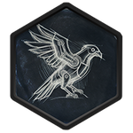 | Vector | 15 Nov 2025 | 15 Nov 2026 | Level: Bronze 3, Silver 9, Gold 13, Platinum 15, Onyx 16. Recursed Agents get Onyx. At least 1 AP in the year | [Fevgames](https://fevgames.net/ingress/ingress-guide/concepts/medal/) | Dates not announced yet: the anniversary is used |

## 2025

| Medal | Year | Start | End | Required actions | Source | Notes |
|---|---|---|---|---|---|---|
| 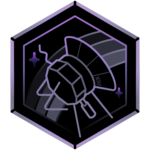 | Voyager | 8 Nov 2024 | 24 Nov 2025 | Level: Bronze 3, Silver 9, Gold 13, Platinum 15, Onyx 16. Recursed Agents get Onyx. At least 1 AP in the year | [Official](https://ingress.com/news/ingress-year-13) | – |

## 2024

| Medal | Year | Start | End | Required actions | Source | Notes |
|---|---|---|---|---|---|---|
| 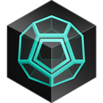 | Catalyst | 10 Nov 2023 | 18 Nov 2024 | Level: Bronze 3, Silver 9, Gold 13, Platinum 15, Onyx 16. Recursed Agents get Onyx. At least 1 AP in the year | [Official](https://ingress.com/news/ingress-year-12) | – |

## 2023

| Medal | Year | Start | End | Required actions | Source | Notes |
|---|---|---|---|---|---|---|
|  | Paragon | 15 Nov 2022 | 20 Nov 2023 | Level: Bronze 3, Silver 9, Gold 13, Platinum 15, Onyx 16. Recursed Agents get Onyx. At least 1 AP in the year | [Official](https://ingress.com/news/ingress-year-11) | – |

## 2022

| Medal | Year | Start | End | Required actions | Source | Notes |
|---|---|---|---|---|---|---|
| 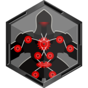 | Pathfinder | 15 Nov 2021 | 21 Nov 2022 | Level: Bronze 3, Silver 9, Gold 13, Platinum 15, Onyx 16. Recursed Agents get Onyx. At least 1 AP in the year | [Official](https://ingress.com/news/ingress-year-10) | – |

## 2021

| Medal | Year | Start | End | Required actions | Source | Notes |
|---|---|---|---|---|---|---|
| 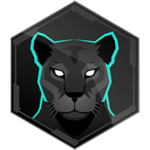 | Persistence | 15 Nov 2020 | 15 Nov 2021 | Level: Bronze 3, Silver 9, Gold 13, Platinum 15, Onyx 16. Recursed Agents get Onyx. At least 1 AP in the year | [Fevgames](https://fevgames.net/ingress/ingress-guide/concepts/medal/) | – |

## 2020

| Medal | Year | Start | End | Required actions | Source | Notes |
|---|---|---|---|---|---|---|
|  | Resonance | 15 Nov 2019 | 15 Nov 2020 | Level: Bronze 3, Silver 9, Gold 13, Platinum 15, Onyx 16. Recursed Agents get Onyx. At least 1 AP in the year | [Fevgames](https://fevgames.net/ingress/ingress-guide/concepts/medal/) | – |

## 2019

| Medal | Year | Start | End | Required actions | Source | Notes |
|---|---|---|---|---|---|---|
| 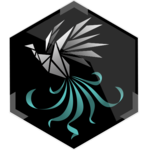 | Resurgence | 15 Nov 2018 | 15 Nov 2019 | Level: Bronze 3, Silver 9, Gold 13, Platinum 15, Onyx 16. Recursed Agents get Onyx | [Fevgames](https://fevgames.net/ingress/ingress-guide/concepts/medal/) | – |

## 2018

| Medal | Year | Start | End | Required actions | Source | Notes |
|---|---|---|---|---|---|---|
| 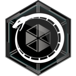 | Ouroboros | 15 Nov 2017 | 15 Nov 2018 | Level: Bronze 3, Silver 9, Gold 13, Platinum 15, Onyx 16. Recursed Agents get Onyx | [Fevgames](https://fevgames.net/ingress/ingress-guide/concepts/medal/) | – |

## 2017

| Medal | Year | Start | End | Required actions | Source | Notes |
|---|---|---|---|---|---|---|
| 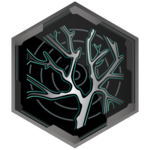 | Sage | 15 Nov 2016 | 15 Nov 2017 | Level: Bronze 3, Silver 9, Gold 13, Platinum 15, Onyx 16. Recursed Agents get Onyx | [Fevgames](https://fevgames.net/ingress/ingress-guide/concepts/medal/) | – |

## 2016

| Medal | Year | Start | End | Required actions | Source | Notes |
|---|---|---|---|---|---|---|
| 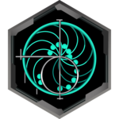 | Luminary | 15 Nov 2015 | 15 Nov 2016 | Level: Bronze 3, Silver 9, Gold 13, Platinum 15, Onyx 16. Recursed Agents get Onyx | [Fevgames](https://fevgames.net/ingress/ingress-guide/concepts/medal/) | – |

## 2015

| Medal | Year | Start | End | Required actions | Source | Notes |
|---|---|---|---|---|---|---|
| 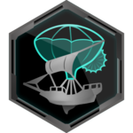 | Vanguard | 15 Nov 2014 | 15 Nov 2015 | Level: Bronze 3, Silver 9, Gold 13, Platinum 15, Onyx 16. Recursed Agents get Onyx | [Fevgames](https://fevgames.net/ingress/ingress-guide/concepts/medal/) | – |

## 2014

| Medal | Year | Start | End | Required actions | Source | Notes |
|---|---|---|---|---|---|---|
| 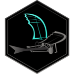 | Innovator | 15 Nov 2013 | 15 Nov 2014 | Level: Bronze 3, Silver 9, Gold 11, Platinum 15, Onyx 16. Recursed Agents get Onyx | [Fevgames](https://fevgames.net/ingress/ingress-guide/concepts/medal/) | – |
