# Ingress Operations

Global Ops, Campaigns and Challenges with a medal of their own, newest first, as of 5 November 2026. XM Anomalies are on their own page.

See also: [XM Anomalies](./anomalies) and [Ingress years](./ingress-years).

## How reliable this is

| Source | Reliability |
|---|---|
| Official | The rules or season page on [ingress.com/news](https://ingress.com/news) |
| Fevgames | The [medal guide](https://fevgames.net/ingress/ingress-guide/concepts/medal/) and reports, community records |

The End column is the last day, as the source gives it, mostly in UTC. A medal you saved in your custom medals is added to your timeline on that day.

## Gaps

- **Tessellation:** the Knight of Tessellation and Tessellation Paragon medals have no end date, so they are not added to the timeline. The Tessellation began in October 2019, and its results came in 2020. No source gives the last day.
- **Redux:** the Memories Global Ops could be earned again through paid Redux Campaigns until 2 February 2026. The timeline still shows such a medal on the end date of the original op.
- **Prime Challenge:** left out, as it counts repeated challenges at several Anomalies.
- **Required actions:** three values mean bronze, silver and gold. They are the main route; the sources give the details.
- **Medals without an op:** only medals the app knows are listed. Supporter, Dispatch reward and yearly medals are not.

## 2026

| Medal | Operation | Start | End | Required actions | Source | Notes |
|---|---|---|---|---|---|---|
|  | Cygnus: Global Battles | 1 Oct | 28 Oct 2026 | The 3 Assignments of the free Dispatch Campaign, for 3 tiers | [Official](https://ingress.com/news/2026-cygnus) | – |
| 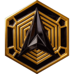 | Apollo: Global Op | 26 Aug | 16 Sep 2026 | Bounties in the 3 Assignments of a Dispatch Campaign, for 3 tiers | [Official](https://ingress.com/news/2026-apollo) | – |
| 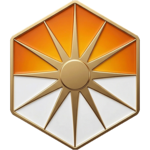 | Summer Solstice 2026 | 5 Jun | 29 Jun 2026 | Assignments of the Dispatch Campaign, each 3 of 4 Bounties such as Kinetic Programs, Resonators and Links. Bronze and Silver | [Official](https://ingress.com/news/2026-summer) | Extended from 22 Jun |
| 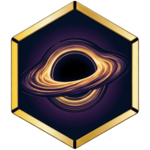 | Orion: Global Op | 24 Apr | 11 May 2026 | Linking and Fielding Bounties in the 3 Assignments of a Dispatch Campaign, for 3 tiers | [Official](https://ingress.com/news/2026-orion) | – |
|  | +Gamma: Global Op | 13 Feb | 23 Feb 2026 | Linking Bounties in the 3 Assignments of a Dispatch Campaign, for 3 tiers | [Official](https://ingress.com/news/2026-plusgamma) | – |
| 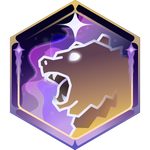 | Operation Polaris | 16 Dec 2025 | 5 Feb 2026 | Daily Bounties. Bronze: 13. Silver: 26. Gold: 39 | [Official](https://ingress.com/news/2025-operationpolaris) | – |

## 2025

| Medal | Operation | Start | End | Required actions | Source | Notes |
|---|---|---|---|---|---|---|
|  | Winter Solstice 2025 Dispatch Challenge | 5 Dec | 22 Dec 2025 | Free Dispatch Campaign of 4 Assignments. Bronze: Assignment 2. Silver: Assignment 4 | [Official](https://ingress.com/news/2025-wintersolstice) | – |
|  | Spyder Web 2025 | 13 Oct | 17 Nov 2025 | Buy the Dispatch Campaign for 15,000 CMU and complete all its Bounties | [Official](https://ingress.com/news/2025-halloween) | Bought until 3 Nov, completed until 17 Nov |
|  | +Alpha: Global Op | 18 Jan | 2 Feb 2025 | Deploy and destroy Mods for the Dispatch Campaign. Bronze: Assignment 1. Silver: Assignment 3 | [Official](https://ingress.com/news/2025-plusalpha) | – |

## 2024

| Medal | Operation | Start | End | Required actions | Source | Notes |
|---|---|---|---|---|---|---|
|  | Erased Memories: Global Op | 12 Oct | 27 Oct 2024 | Dispatch Campaign. Bronze: Assignment 4. Silver: Assignment 9 | [Official](https://ingress.com/news/2024-erasedmem) | – |
|  | Field Test: Dispatch | 23 Aug | 2 Sep 2024 | Dispatch Campaign. Bronze: Assignment 2. Silver: Assignment 6 | [Official](https://ingress.com/news/2024-fieldtestdispatch) | – |
|  | Shared Memories: Operation | 12 Jul | 5 Aug 2024 | Points: 3 per Link, 1 per opponent Link destroyed, bonus for Linkstars. Bronze: 2,000. Silver: 10,000 | [Official](https://ingress.com/news/2024-sharedmem) | – |
| 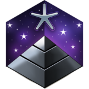 | Buried Memories: Global Op | 12 Apr | 6 May 2024 | Points for Links and Fields made and destroyed, more for larger Fields. Bronze: 1,000. Silver: 10,000 | [Official](https://ingress.com/news/2024-buriedmem) | – |
| 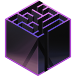 | Cryptic Memories: Global Op | 12 Jan | 5 Feb 2024 | Points: 2 per Resonator deployed or upgraded on another Agent's, 1 per Resonator destroyed. Bronze: 1,500. Silver: 15,000 | [Official](https://ingress.com/news/2024-crypticmem) | – |
| 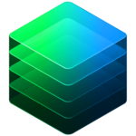 | Chronos | 6 Dec 2023 | 6 Jan 2024 | Points: 2 per Overclock Hack Point, 1 per Portal capture, 1 per Mod deployed. Bronze: 500. Silver: 5,000 | [Official](https://ingress.com/news/2023-chronos-ops) | – |

## 2022

| Medal | Operation | Start | End | Required actions | Source | Notes |
|---|---|---|---|---|---|---|
| 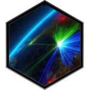 | Peace Day 2022 | 15 Sep | 26 Sep 2022 | Create 200 Links | [Fevgames](https://fevgames.net/ingress/ingress-guide/concepts/medal/) | – |
| 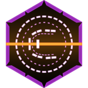 | Solstice Recharge Challenge | 9 Jun | 21 Jun 2022 | Recharge 300,000 XM | [Fevgames](https://fevgames.net/solstice-recharge-challenge/) | – |
|  | EOS Imprint | 26 May | 6 Jun 2022 | Event Points, such as 25 per Field of 50k+ MU and 16 per Portal Scan. Bronze: 2,000. Silver: 4,000. Gold: 8,000 | [Official](https://ingress.com/news/eos-imprint-2022) | – |
|  | C. Sans | 31 Mar | 7 Apr 2022 | Create Links: 4, 41 or 401 | [Fevgames](https://fevgames.net/ingress/ingress-guide/concepts/medal/) | – |

## 2021

| Medal | Operation | Start | End | Required actions | Source | Notes |
|---|---|---|---|---|---|---|
|  | Courier Meet You Out There Challenge | 20 Aug | 30 Aug 2021 | AP from event Portals: 88,888, 888,888 or 2,888,888 | [Fevgames](https://fevgames.net/ingress/ingress-guide/concepts/medal/) | – |
| 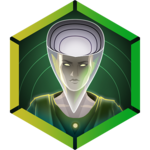 | Optima Kinetic Capsule Challenge | 17 Sep | 27 Sep 2021 | Complete Kinetic Capsules: 4, 16 or 50 | [Fevgames](https://fevgames.net/optima-kinetic-challenge-ii/) | Second round, with Silver and Gold. The first ran from 19 to 29 Mar and gave Bronze |

## 2020

| Medal | Operation | Start | End | Required actions | Source | Notes |
|---|---|---|---|---|---|---|
|  | Didact Field Challenge | 14 Feb | 24 Feb 2020 | Create Control Fields: 100, 300 or 800 | [Fevgames](https://fevgames.net/ingress/ingress-guide/concepts/medal/) | – |
|  | Nemesis: Perpetua | 29 Feb | 29 Feb 2020 | All six Hexathlon challenges. Elite: top 10% in any one challenge | [Fevgames](https://fevgames.net/ingress/ingress-guide/concepts/medal/) | – |

## 2019

| Medal | Operation | Start | End | Required actions | Source | Notes |
|---|---|---|---|---|---|---|
| 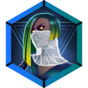 | Umbra Deploy Challenge | 20 Dec | 30 Dec 2019 | Deploy Resonators: 120, 600 or 1,440 | [Fevgames](https://fevgames.net/ingress/ingress-guide/concepts/medal/) | Fevgames gives 2020; reports from December 2019 show the year is 2019 |
| 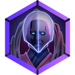 | Avenir Shard Challenge | 17 Sep | 30 Sep 2019 | Hack a Portal during the Shard period | [Fevgames](https://fevgames.net/ingress/ingress-guide/concepts/medal/) | – |
|  | Field Test: Hexathlon | 14 Sep | 14 Sep 2019 | All six challenges. Elite: top 10% in the city | [Community](https://massivelyop.com/2019/09/13/ingress-primes-upcoming-hexathlon-will-kick-off-a-new-series-of-events-for-the-ar-mobile-title/) | – |
| 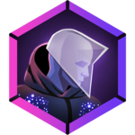 | Aurora Glyph Challenge | 15 Aug | 26 Aug 2019 | Challenge points: 100, 500 or 1,000 | [Fevgames](https://fevgames.net/ingress/ingress-guide/concepts/medal/) | – |
|  | Myriad Hack Challenge | 11 Jul | 22 Jul 2019 | Hack unique Portals: 100, 350 or 750 | [Fevgames](https://fevgames.net/ingress/ingress-guide/concepts/medal/) | – |
| 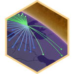 | Dark XM | 30 Apr | 30 Apr 2019 | Take part in the Dark XM event. The tiers are not found | [Fevgames](https://fevgames.net/ingress/ingress-guide/concepts/medal/) | – |

## 2018

| Medal | Operation | Start | End | Required actions | Source | Notes |
|---|---|---|---|---|---|---|
|  | Cassandra Neutralizer | 13 Jul | 22 Jul 2018 | Neutralize event Portals: 100, 300 or 1,000 | [Fevgames](https://fevgames.net/ingress/ingress-guide/concepts/medal/) | – |

## 2017

| Medal | Operation | Start | End | Required actions | Source | Notes |
|---|---|---|---|---|---|---|
| 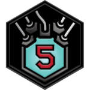 | EXO5 Controller | 2 Oct | 16 Oct 2017 | Create Control Fields: 100, 500 or 2,000 | [Fevgames](https://fevgames.net/ingress/ingress-guide/concepts/medal/) | – |
| 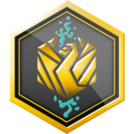 | Magnus Builder | 5 May | 21 May 2017 | Deploy Resonators to unique slots. Builder: 1,331. Architect: 3,113 | [Fevgames](https://fevgames.net/ingress/ingress-guide/concepts/medal/) | – |

## 2016

| Medal | Operation | Start | End | Required actions | Source | Notes |
|---|---|---|---|---|---|---|
| 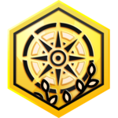 | Via Lux Adventure | 1 Sep | 30 Sep 2016 | Visit unique Portals. Adventurer: 300. Odyssey: the top 25% beyond that | [Fevgames](https://fevgames.net/via-lux-adventurer-medal/) | The whole of September; the source gives no end time |

## No end date

| Medal | Operation | Start | End | Required actions | Source | Notes |
|---|---|---|---|---|---|---|
| 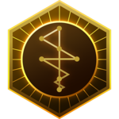 | Knight of Tessellation | Oct 2019 | – | Faction result. Gold: the winning Faction. Silver: the runner-up | [Community](https://notnianticlabs.com/the-tessellation-a-primer/) | Results in 2020 |
|  | Tessellation Paragon | Oct 2019 | – | High participation | [Community](https://notnianticlabs.com/the-tessellation-a-primer/) | Results in 2020 |
