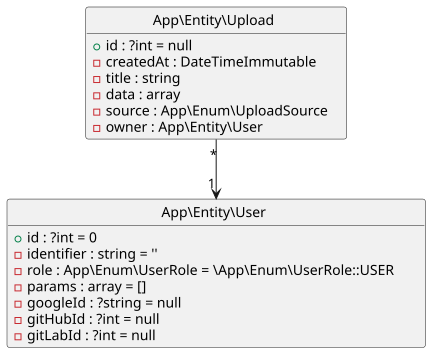

# Upload Page

[](https://github.com/elkuku/android-upload-test/actions/workflows/symfony-tests.yml)


## What's this??
The [Symfony](https://symfony.com) web app that receives JSON uploads from the Android app in
[`../upload-app`](../upload-app) and lists them on the web. It includes:

* `POST /api/uploads` — JSON API, authenticated with a Google ID token (`Authorization: Bearer …`).
  Only known users are accepted; accounts are never created automatically.
* `/uploads` — each user's uploads, plus a web form to create one by hand
* Symfony 8.*, PostgreSQL via Docker compose
* `dev` login form <br/> `prod` Social login with Google, GitLab, GitHub
* A user CRUD interface
* Bootstrap

Setting up Google Sign-In for the app: [docs/google-sign-in-setup.md](../docs/google-sign-in-setup.md).

## Installation
Clone the repo then use the
```shell
bin/install
```
command OR execute the script content manually.
   
## Usage
Create and administer user accounts.
```shell
symfony console user-admin
```
Start and stop the environment.
```shell
bin/start
```
```shell
bin/stop
```


## Testing

```shell
make tests
```

## Check for updates
Check four outdated PHP deps, recipes and assets.

```shell
composer check
```

## Database



You can create this with 

```shell
composer db-diagram
```

----

Happy coding `=;)`
