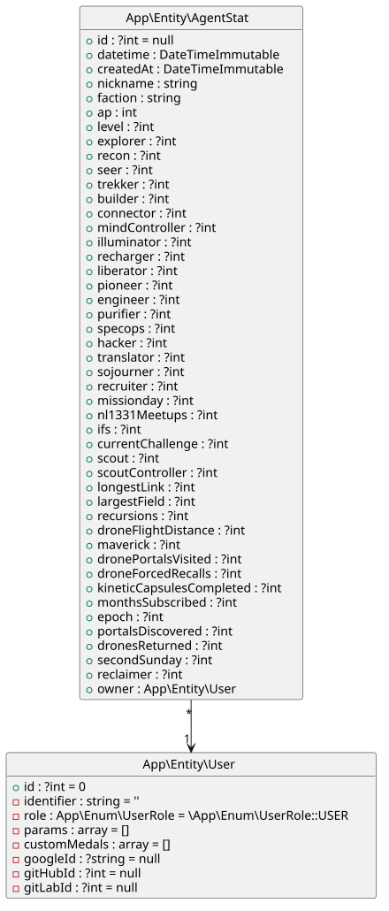

# AgentTools – web

[](https://github.com/elkuku/AgentTools/actions/workflows/symfony-tests.yml)

## What's this?
The [Symfony](https://symfony.com) web app that stores Ingress agent stats, sent by the Android app
in [`../app`](../app), and lists them. It includes:

* [API Platform](https://api-platform.com) JSON-LD API (`/api/agent-stats`, `/api/me`),
  authenticated with a Google ID token (`Authorization: Bearer …`). Only known users are accepted;
  accounts are never created automatically. OpenAPI docs at `/api/docs`.
* `/agent-stats` — each user's stats
* Stats stored in `agent_stat` with the columns of 4e-website
* Symfony 8.*, PostgreSQL via Docker compose
* `dev` login form <br/> `prod` Social login with Google, GitLab, GitHub
* A user CRUD interface
* Bootstrap

Setting up Google Sign-In for the app: [docs/google-sign-in-setup.md](../docs/google-sign-in-setup.md).

## Installation
In this folder (`web/`), run

```shell
bin/install
```

or run the steps in that script by hand. It installs the dependencies, starts the database
container, runs the migrations and starts the Symfony server.

Google credentials (`OAUTH_GOOGLE_ID`, …) go in `.env.local`.

## Usage
Create and administer user accounts. The API only accepts Google accounts that exist here,
with their email address as identifier.
```shell
symfony console user-admin
```
Start and stop the environment.
```shell
bin/start
```
```shell
bin/stop
```

## API

Ingress all-time stats, stored in `agent_stat` with the columns of 4e-website. The app converts
stats shared from Ingress into this format; the keys are the column names.

Built with [API Platform](https://api-platform.com): JSON-LD (`application/ld+json`), errors as
RFC 7807 problems (`application/problem+json`). The interactive docs are at `/api/docs` (linked in
the footer): click **Authorize** and paste a Google ID token (without `Bearer `). After a Google
sign-in on the web, `/profile` shows yours with a copy button (valid for about an hour). In `dev` with
`APP_FAKE_GOOGLE_TOKENS=1`, a fake token works: `fake|<googleId>|<email>|verified`.

```http
POST /api/agent-stats
Authorization: Bearer <Google ID token>
Content-Type: application/ld+json

{ "datetime": "2026-10-19 15:35:56", "nickname": "Agent", "faction": "Enlightened",
  "ap": 243517130, "level": 16, "explorer": 27659, "mind_controller": 35236, … }
```

`datetime`, `nickname`, `faction` and `ap` are required; the other stats are optional integers.

| Status | Body                                                                              |
|--------|-----------------------------------------------------------------------------------|
| `201`  | the `AgentStat` (`@id`, `id`, `createdAt`, the stats), `Location: /api/agent-stats/1` |
| `401`  | problem, `detail`: missing/invalid token, unverified email, unknown user          |
| `403`  | problem, `detail`: the user lacks the Agent role (`ROLE_AGENT`); listing and reading need it too |
| `409`  | problem, `detail`: `Stat entry already added!` (same user and `datetime` again)   |
| `422`  | problem with `violations` (`propertyPath`, `message`)                             |

| Endpoint                   | Returns                                                                    |
|----------------------------|----------------------------------------------------------------------------|
| `GET /api/agent-stats`     | the user's stats, newest first: a collection (`member`, `totalItems`), 30 per page, `view.next` links the next page |
| `GET /api/agent-stats/{id}`| one stat, `403` if it is someone else's                                    |
| `GET /api/me`              | the signed-in user: `id`, `identifier`, `role`                             |

`datetime` comes back in the input format (`Y-m-d H:i:s`), the stats under their column names.

## Testing

```shell
make tests
```

Runs PHPUnit, PHPStan, Rector (dry run) and PHP-CS-Fixer.

## Check for updates
Check for outdated PHP deps, recipes and assets.

```shell
composer check
```

## Database



You can create this with 

```shell
composer db-diagram
```

----

Happy coding `=;)`
